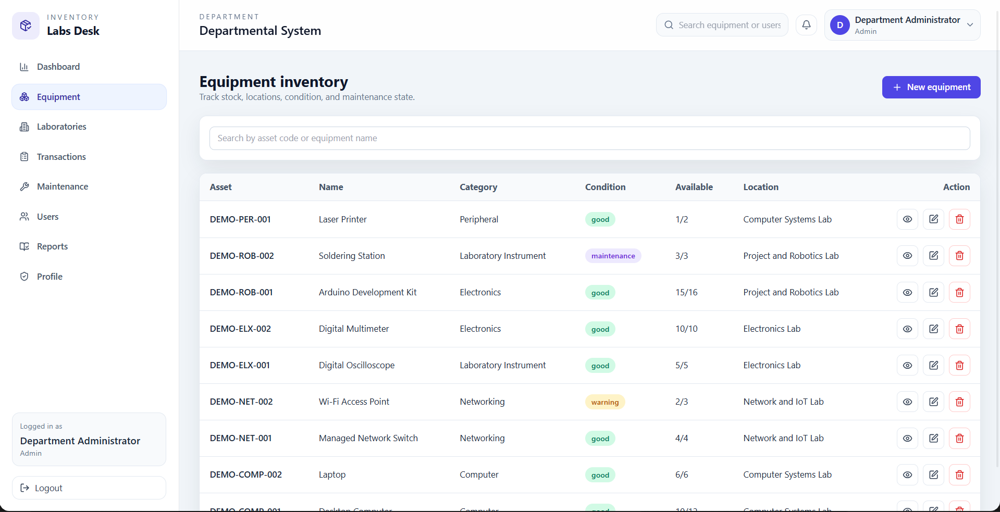

# Departmental Inventory and Lab Equipment Checker

A full-stack MERN project for managing lab equipment, maintenance, issue/return workflow, and department inventory reporting.

## Project overview

This application is designed for a college department to track laboratory equipment, stock availability, equipment requests, maintenance records, and user roles. It is structured for a practical academic portfolio project and focuses on real data persistence and administrative workflows rather than decorative templates.

## Features

- JWT-based authentication with bcrypt password hashing
- Public faculty signup; staff roles remain administrator-managed
- Role-based access for admin, lab assistant, and faculty
- Equipment CRUD with stock and condition tracking
- Laboratory management and room allocation
- Transaction lifecycle for issue/approval/return workflows
- Maintenance record tracking and resolution
- Dashboard metrics and report exports
- CSV report generation for inventory and maintenance data

## User roles

- Admin: full access to users, equipment, transactions, maintenance, reports, and dashboard
- Lab assistant: help manage inventory and issue-return operations
- Faculty: request equipment and view inventory information, but cannot manage users or system settings

## Technology stack

- React.js + Vite + React Router
- Tailwind CSS
- Axios
- Node.js + Express.js
- MongoDB + Mongoose
- JWT + bcryptjs
- Vitest + Supertest

## Project structure

```text
departmental-inventory-checker/
├── client/
│   ├── src/
│   ├── .env.example
│   ├── index.html
│   ├── package.json
│   ├── postcss.config.js
│   ├── tailwind.config.js
│   └── vite.config.js
├── docs/
│   ├── API_DOCUMENTATION.md
│   └── DATABASE_SCHEMA.md
├── server/
│   ├── config/
│   ├── controllers/
│   ├── middleware/
│   ├── models/
│   ├── routes/
│   ├── scripts/
│   ├── tests/
│   ├── .env.example
│   ├── app.js
│   ├── server.js
│   └── package.json
├── .gitignore
├── package.json
└── README.md
```

## Prerequisites

- Node.js v18+ recommended
- npm v9+
- MongoDB server or MongoDB Atlas account

## Installation

1. Install dependencies from the project root:

```bash
npm install
```

2. Configure environment files:

```bash
cp server/.env.example server/.env
cp client/.env.example client/.env
```

3. Update the values in `server/.env` and `client/.env`.

## Environment configuration

### Server `.env`

```env
PORT=5000
NODE_ENV=development
MONGODB_URI=mongodb://127.0.0.1:27017/department_inventory
JWT_SECRET=<generate-a-unique-random-value>
JWT_EXPIRES_IN=7d
CLIENT_URL=http://localhost:5173
COOKIE_NAME=department_inventory_token
COOKIE_SECURE=false
```

### Client `.env`

```env
VITE_API_URL=http://localhost:5000/api/v1
```

Generate a JWT secret in PowerShell with:

```powershell
[Convert]::ToBase64String([Security.Cryptography.RandomNumberGenerator]::GetBytes(32))
```

Copy the generated value into `JWT_SECRET` in `server/.env`. Keep it private and do not commit `.env` files.

### MongoDB Atlas setup

- Create a MongoDB Atlas cluster.
- Create a database user.
- Get the connection string.
- Replace `MONGODB_URI` in `server/.env` with the Atlas URI.

## Bootstrap the first administrator

This project uses a safe bootstrap command instead of a public registration endpoint.

```bash
npm run bootstrap:admin
```

Set the following before running it:

```env
ADMIN_NAME=Department Administrator
ADMIN_EMAIL=admin@college.edu
ADMIN_PASSWORD=Admin@123
ADMIN_DEPARTMENT=Computer Science
```

If an admin already exists, the script exits without overwriting the account.

## Add development demo inventory

After configuring `server/.env` and creating the first administrator, seed sample departments, laboratories, equipment, transactions, maintenance records, and demo staff accounts:

```bash
npm run seed:demo
```

The seed command is additive and idempotent: it only creates missing records with `DEMO-` asset/reference codes, never resets existing passwords or deletes data. It requires an active administrator. Sample logins (created only when those email addresses do not already exist):

| Role | Email | Password |
|---|---|---|
| Faculty | `faculty.demo@college.edu` | `Faculty@123` |
| Lab assistant | `assistant.demo@college.edu` | `LabAssistant@123` |

These are development demonstration credentials. Change or remove these accounts before using a non-development database.

Faculty can also create their own account at `/signup`. Public signup always assigns the faculty role; admins and lab assistants must be created by an administrator or the demo seed script.

## Run the project

From the root directory:

```bash
npm run dev
```

This starts the frontend and backend together using concurrently.

### Individual commands

```bash
npm run seed:demo
npm run client
npm run server
npm run build
npm test
```

## API documentation

See [docs/API_DOCUMENTATION.md](./docs/API_DOCUMENTATION.md).

## Database schema

See [docs/DATABASE_SCHEMA.md](./docs/DATABASE_SCHEMA.md).

## Authentication and authorization

- Login authenticates the user and stores a secure httpOnly cookie.
- Requests include the cookie automatically through Axios with credentials enabled.
- Protected routes require a valid token.
- Role checks are enforced on the backend using authorization middleware.
- Faculty accounts can request and view inventory but cannot manage users or system-level settings.

## Inventory issue/return workflow

1. Faculty submits a request for equipment.
2. Admin or lab assistant approves the request.
3. Issue action reduces available quantity and marks the transaction as issued.
4. Return action increments available quantity and marks the transaction as returned.
5. Dashboard and stock totals update based on database state.

## Testing

```bash
npm test
```

The server tests cover authentication, invalid stock prevention, inventory issuance workflow, and maintenance resolution.

## Troubleshooting

- If MongoDB connection fails, verify `MONGODB_URI` and ensure the database is reachable.
- If login is rejected, confirm bcrypt password hash and JWT secret values are set correctly.
- If Vite cannot reach the backend, confirm `VITE_API_URL` points to the correct port.
- If the bootstrap script reports that an admin already exists, delete the existing admin or connect to a fresh database.

## Screenshots

Screenshots below were captured from the running application with the seeded MongoDB demo data.

### Dashboard


### Equipment inventory




### Issue and return transactions


### Maintenance


## Future improvements

- Add more granular inventory reservations and approvals
- Expand reporting filters and export options
- Add QR code asset tracking
- Integrate notifications and reminders for overdue items
- Add automated maintenance scheduling

## Academic project context

This project is intended as a 5th-semester MERN Stack academic submission and a portfolio-ready demonstration of practical college inventory management workflows.
