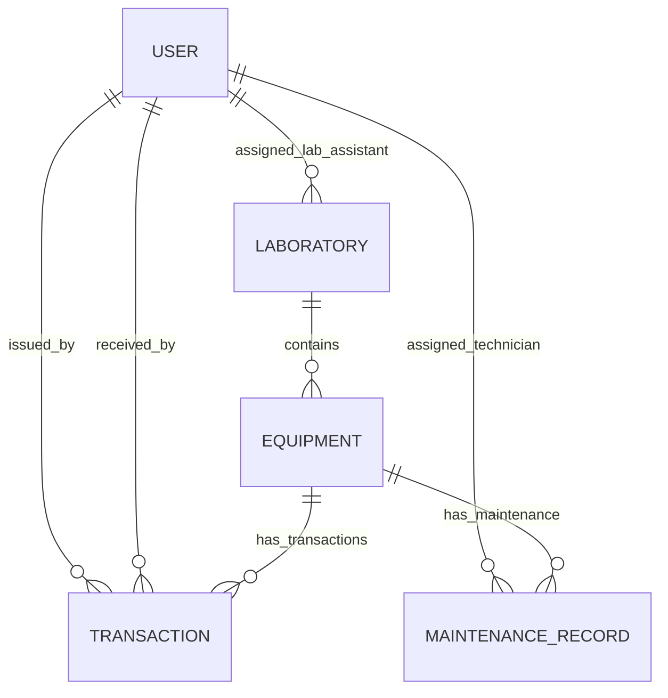

# Database schema

This project uses MongoDB with Mongoose models. Relationships are represented with ObjectId references and embedded document patterns where appropriate.

## Collections

### User

Fields:
- `name` (String, required)
- `email` (String, required, unique)
- `passwordHash` (String, required)
- `role` (`admin`, `lab_assistant`, `faculty`)
- `department` (String)
- `isActive` (Boolean, default `true`)
- timestamps

Indexes:
- Unique index on `email`
- Index on `role`

### Equipment

Fields:
- `assetCode` (String, unique, required)
- `name` (String, required)
- `description` (String)
- `category` (`Computer`, `Peripheral`, `Networking`, `Electronics`, `Laboratory Instrument`, `Furniture`, `Other`)
- `manufacturer`, `modelNumber`, `serialNumber`
- `laboratory` (ObjectId -> Laboratory)
- `totalQuantity`, `availableQuantity`
- `condition` (`new`, `good`, `warning`, `damaged`, `maintenance`)
- `minStockThreshold`
- purchase and warranty metadata
- `archived` (Boolean)
- timestamps

Indexes:
- Unique asset code index
- Compound index on `category`, `laboratory`, `condition`

### Laboratory

Fields:
- `name`, `code` (unique), `department`, `building`, `roomNumber`
- `assignedLabAssistant` (ObjectId -> User)
- `capacity`, `description`, `isActive`
- timestamps

### Transaction

Fields:
- `referenceNumber` (String, unique)
- `equipment` (ObjectId -> Equipment)
- `borrowerName`, `borrowerEmail`, `borrowerRole`
- `quantity`, `issueDate`, `expectedReturnDate`, `actualReturnDate`
- `status` (`pending`, `approved`, `issued`, `returned`, `rejected`, `overdue`)
- `issuedBy`, `receivedBy`
- `notes`, timestamps

### MaintenanceRecord

Fields:
- `equipment` (ObjectId -> Equipment)
- `issueType` (`damaged`, `malfunctioning`, `preventive`, `inspection`, `missing`)
- `description`, `reportedBy`, `reportedDate`
- `priority`, `status`, `assignedTechnician`
- `resolutionNotes`, `repairCost`, `resolutionDate`
- timestamps

## Relationship overview

## Notes

- MongoDB uses document references rather than SQL-like foreign keys.
- Stock consistency is enforced in the backend services, not only in validation.
- The issue/return workflow updates both transaction and equipment records to keep available quantity aligned with reality.
